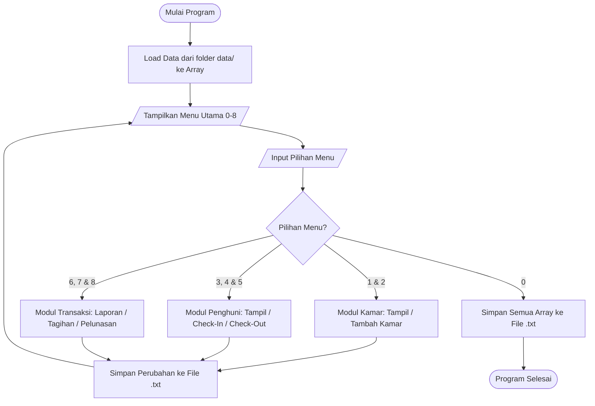

# 🏠 Sistem Manajemen Sewa Kamar Kos (Berbasis Konsol)

Aplikasi berbasis konsol (*Command Line Interface*) yang dibangun menggunakan **Bahasa C** dengan pendekatan **Pemrograman Modular** untuk membantu pengelolaan operasional rumah kos secara efisien, terstruktur, dan tersimpan secara permanen.

## 👥 Anggota Kelompok 2
* **Alfarabi Rasebdriya**
* **Dwinita Maria Novela**
* **Irfan Islami Parsa**
* **Nadira Syafiyah Hasibuan**
* **Rizky Dwi Putra**

---

## 🎯 Tujuan & Fitur Utama Aplikasi
1. **Manajemen Data Kamar:** Melihat daftar kamar beserta status ketersediaan (`Kosong` / `Terisi`), harga sewa bulanan, tipe kamar, serta menambah unit kamar baru.
2. **Manajemen Penghuni (*Check-In* & *Check-Out*):** Mendaftarkan penyewa baru ke kamar yang tersedia (status kamar otomatis berubah menjadi `Terisi`) serta memproses penghuni keluar (kamar otomatis kembali menjadi `Kosong`).
3. **Manajemen Transaksi & Keuangan:** Mencatat tagihan sewa bulanan, menerapkan potongan diskon otomatis untuk pembayaran jangka panjang, melunasi tagihan, serta menghitung total pemasukan kos secara akurat.
4. **Penyimpanan Data Permanen (*File Handling*):** Seluruh perubahan data otomatis disimpan ke dalam file teks (`.txt`) sehingga data tetap aman meskipun program ditutup.

---

## 📂 Struktur Folder & File Proyek

```text
manajemen-sewa-kamar-kos/
├── data/                   # Penyimpanan database berbasis file teks (.txt)
│   ├── kamar.txt           # Data kamar (Nomor;Tipe;Harga;Status)
│   ├── penghuni.txt        # Data penyewa (ID;Nama;NoHP;NomorKamar;TglMasuk)
│   └── transaksi.txt       # Data pembayaran (IDTrx;IDPenghuni;Kamar;Bulan;Nominal;Status)
├── include/                # Header files (.h) untuk deklarasi struct & prototipe fungsi
│   ├── model.h             # Definisi struct (Kamar, Penghuni, Transaksi) & konstanta
│   ├── file_manager.h      # Deklarasi operasi baca/tulis file
│   ├── kamar.h             # Deklarasi modul manajemen kamar
│   ├── penghuni.h          # Deklarasi modul manajemen penghuni
│   ├── transaksi.h         # Deklarasi modul transaksi & laporan keuangan
│   └── utils.h             # Deklarasi fungsi bantu & validasi input
├── src/                    # Source files (.c) berisi implementasi logika program
│   ├── main.c              # Titik masuk program & navigasi menu utama
│   ├── file_manager.c      # Implementasi penyimpanan & pembacaan file (fopen/fscanf/fprintf)
│   ├── kamar.c             # Implementasi fitur kamar
│   ├── penghuni.c          # Implementasi fitur penghuni
│   ├── transaksi.c         # Implementasi perhitungan tagihan & diskon
│   └── utils.c             # Implementasi pembersih layar & validasi input angka
├── .gitignore              # Mengabaikan file hasil kompilasi (*.exe, *.o)
└── README.md               # Dokumentasi proyek
```

---

## 🧠 Konsep Pemrograman C yang Diterapkan

| Konsep Materi | Implementasi dalam Kode | Lokasi File |
| :--- | :--- | :--- |
| **Array & Struct** | Penggunaan *Array of Struct* (`Kamar[]`, `Penghuni[]`, `Transaksi[]`) berkapasitas `MAX_DATA` (100) untuk menampung data di memori. | `include/model.h`, `src/main.c` |
| **Pemrograman Modular** | Pemisahan antara file deklarasi/antarmuka (`.h` di folder `include/`) dan file implementasi (`.c` di folder `src/`). | Seluruh folder `include/` & `src/` |
| **Fungsi (*Return Value*)** | Fungsi yang mengembalikan nilai, seperti `cariIndeksKamar()`, `hitungTotalPemasukan()`, dan `inputAngkaValid()`. | `src/kamar.c`, `src/transaksi.c`, `src/utils.c` |
| **Prosedur (`void`)** | Sub-program tanpa nilai balik untuk menampilkan tabel dan memodifikasi data, seperti `tampilkanKamar()` dan `tambahPenghuni()`. | `src/kamar.c`, `src/penghuni.c` |
| **Percabangan (`if - else if - else`)** | Validasi ketersediaan kamar, pengecekan menu utama, serta perhitungan diskon sewa (10% untuk 12 bulan, 5% untuk $\ge$ 6 bulan). | `src/main.c`, `src/transaksi.c` |
| **Perulangan `do-while`** | Digunakan pada menu utama agar program berjalan minimal satu kali dan terus berulang hingga pengguna memilih `0` (Keluar). | `src/main.c` |
| **Perulangan `for`** | Digunakan untuk menelusuri seluruh elemen array saat menampilkan tabel data, mencari ID/nomor kamar, dan menggeser elemen array saat hapus data. | `src/kamar.c`, `src/penghuni.c` |
| **Perulangan `while`** | Digunakan untuk membaca baris demi baris isi file `.txt` hingga akhir file (`EOF`) serta memvalidasi input angka pengguna. | `src/file_manager.c`, `src/utils.c` |

---

## 🔄 Alur Kerja Program (*Flowchart*)



---

## ⚙️ Cara Compile dan Menjalankan Program

### 1. Prasyarat
* Compiler **GCC** (MinGW / MSYS2 untuk Windows, atau GCC bawaan di Linux/macOS).
* Pastikan terminal berada di direktori utama proyek (`manajemen-sewa-kamar-kos/`).

### 2. Kompilasi Program
Jalankan perintah berikut di terminal untuk mengompilasi seluruh file sumber secara bersamaan:

```bash
gcc src/main.c src/file_manager.c src/kamar.c src/penghuni.c src/transaksi.c src/utils.c -Iinclude -o kos.exe
```

### 3. Menjalankan Aplikasi
* **Windows (PowerShell / CMD):**
  ```powershell
  .\kos.exe
  ```
* **Linux / macOS:**
  ```bash
  ./kos.exe
  ```